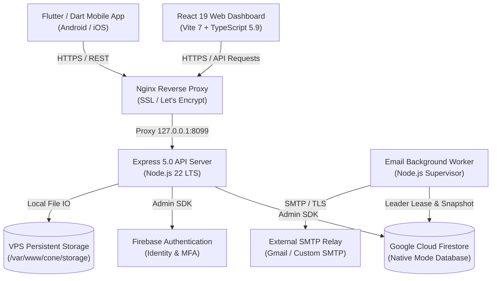
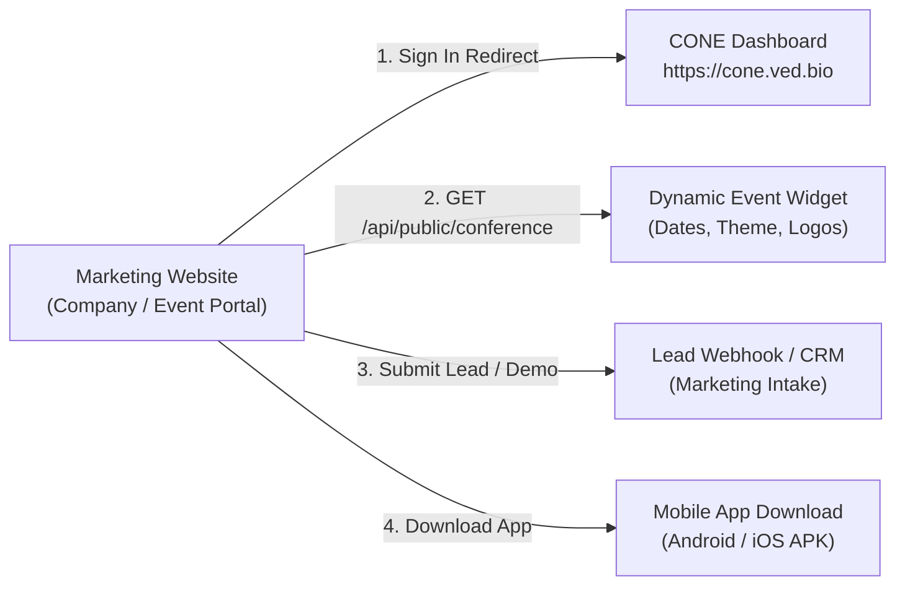

# CONE (Conference Operations & Networking Environment)
## Comprehensive Product & Marketing Technical Documentation

> **Document Version:** 1.0.0  
> **Target Audience:** Marketing Team, Growth Engineers, Web Integration Developers, and Product Stakeholders  
> **Last Verified:** October 2026  
> **Source Code Scope:** `cone-admin-dashboard` & Express Backend Services  

---

## Executive Summary

**CONE** (*Conference Operations & Networking Environment*) is an enterprise-grade conference and scientific event management SaaS platform. It bridges administrative conference coordination with on-ground physical venue logistics, attendee scheduling, digital access control, meal coupon redemption, and mobile participant access.

This document provides the marketing and website development teams with the full product breakdown, verified technical specifications, API structures, website integration guidelines, branding resources, and verifiable marketing assets based on the active codebase.

---

## 1. Product Details

### 1.1 Complete List of Available Features and Modules

CONE provides twenty core functional modules spanning executive governance, scientific coordination, physical logistics, and communication:

| # | Feature / Module | Purpose | Primary Target User |
|---|---|---|---|
| 1 | **Overview Analytics Dashboard** | Real-time conference telemetry, registration totals, meal counts, fee totals, and activity feeds. | Super Admin, Conference Admin, Organizers |
| 2 | **User & Session Management** | Administrator onboarding, account activation/deactivation, session revocation, and security recovery. | Super Admin |
| 3 | **Granular Role-Based Access Control (RBAC)** | Customizable permission matrices across modules with read, write, and archive restrictions. | Super Admin |
| 4 | **Participant Management Directory** | Comprehensive attendee registry with advanced filtering, server-side cursor pagination, and instant search. | Registration Managers, Organizers |
| 5 | **Department Records Explorer** | Academic and institutional drill-down grouping authors, research abstracts, and departmental exports. | Programme Managers, Academic Reviewers |
| 6 | **Scientific Programme & Sessions** | Conference schedule coordination, session planning, timeline management, and venue allocation. | Programme Managers, Organizers |
| 7 | **Research Papers & Abstract Tracking** | Tracking submissions, submission IDs (`ABS-*`), author ordering, disciplines, and presentation types (Oral/Poster). | Programme Managers, Academic Committees |
| 8 | **Disciplines & Categories Management** | Definition of academic branches, category tiers (I–IV), and oral vs. poster slot capacity quotas. | Programme Managers |
| 9 | **Venues & Hall Allocation** | Spatial management of lecture halls, auditoriums, room locations, and seated attendee capacity constraints. | Event Coordinators, Logistics Staff |
| 10 | **Staff & Volunteer Duty Coordination** | Assignment of operational responsibilities, shift times, and dedicated VIP liaison linkages. | Organizers, Volunteer Leads |
| 11 | **Administrative Fee Records** | Tracking participant payment statuses (`pending`, `received`, `waived`, `refunded`), references, and workbook comparisons. | Finance Team, Registration Desk |
| 12 | **Cryptographic Digital Passes** | Generation and verification of HMAC-SHA256 tamper-proof digital QR entry passes for attendees. | Gate Staff, Registration Desk |
| 13 | **Meal Management & Redemption Desk** | Meal window definitions (Breakfast, Lunch, Dinner) and transactional one-click barcode coupon redemption. | Meal Desk Staff, Catering Leads |
| 14 | **Excel Workbook Intake & Import Engine** | Multi-sheet spreadsheet validator, column auto-mapper, pre-flight error analyzer, and isolated batch processor. | Data Entry Staff, Registration Team |
| 15 | **Branded Communication & Email Center** | Responsive HTML email templating (Navy/Teal theme), automated bulk dispatching, and retry workers. | Marketing & Communications Leads |
| 16 | **Mobile Application Authentication Bridge** | Passwordless numeric 6-digit Email OTP login bridge generating Firebase custom tokens for native apps. | Mobile App Participants |
| 17 | **Participant Self-Service Workspace** | Privacy-isolated personal portal where attendees review their verified profile, schedule, and meal passes. | Attendees, Presenters, VIPs |
| 18 | **Conference Branding & Public Showcase** | Control over conference name, edition, dates, themes, partner logos, and sign-in screen promotional panels. | Marketing Team, Conference Chairs |
| 19 | **Enterprise Excel Reports & Export** | Filtered participant data and financial export engine producing clean `.xlsx` reports (up to 5,000 rows/export). | Conference Directors, Finance Staff |
| 20 | **System Health & Audit Governance** | Real-time monitoring of database health, background worker status, operational switches, and immutable audit logs. | Technical Administrators, IT Auditors |

---

### 1.2 Detailed Explanation of Key Features and Modules

#### A. Overview & Analytics
* **Unified Metrics:** Displays live registration counts segmented by conference roles (`presenter`, `attendee`, `speaker`, `vip`, `organiser`, `volunteer`), confirmed statuses, meals served, and collected fee amounts.
* **Quota-Optimized Aggregation:** Uses Firestore server-side count aggregations, consuming only minimal database reads rather than downloading full document payloads.
* **Resilient Fallback & Memory Cache:** Automatically caches dashboard responses for 30 seconds and gracefully falls back to lightweight projection if database index provisioning is pending.
* **Audit Trail:** Shows the 8 most recent security and administrative actions directly on the dashboard home screen.

#### B. Participant Directory & Academic Department Explorer
* **High-Density Data Grid:** Displays attendees with affiliations, categories, oral/poster presentation types, accommodation flags, travel assistance requirements, and contact identifiers.
* **Indexed Server Search:** Uses normalized search keys to instantly look up participants by name, email, mobile number, or registration details across thousands of rows.
* **Department Clustering:** Aggregates multi-author institutional records by scientific discipline (e.g., Earth Sciences, Biotechnology), enabling department chairs to search abstracts and download discipline-specific rosters.

#### C. Enterprise Spreadsheet Import Center
* **Pre-Flight Inspection:** Accepts `.xlsx` workbooks, analyzes all worksheets, checks for required headers, and presents preview rows without writing to the database.
* **Column Mapping:** Automatically detects variations in column names (e.g., "Name of Author", "Full Name", "Contact No", "Mobile").
* **Isolated Batch Processing:** Processes rows individually inside transactional batches. If one row has a validation defect, valid rows are still safely saved.
* **Error Correction Reports:** Automatically produces an actionable `rows-to-fix.xlsx` file containing only rejected records with exact error reasons annotated per row.

#### D. Physical Venue Logistics: Signed Passes & Meal Coupons
* **HMAC-SHA256 Digital Entry Passes:** Passes are cryptographically signed using a secure server-side secret (`PASS_SIGNING_SECRET`). Badges cannot be forged or duplicated.
* **Single-Use Meal Coupon Redemption:** Organizers define meal windows (e.g., Lunch Day 1). The Meal Desk interface verifies coupon validity in real time and marks it redeemed transactionally, preventing double-serving.

#### E. Branded Email Center & Asynchronous Worker
* **Responsive HTML Engine:** Delivers branded, accessibility-compliant HTML emails matching the product’s navy/teal design language with clean fallback to plain text.
* **Reliable Asynchronous Spool:** Emails are stored in a Firestore queue. An independent worker process claims jobs with a transactional distributed leader lease, ensuring high throughput without duplicate dispatches.
* **Zero Quota Exhaustion:** The worker operates via reactive document snapshots rather than aggressive polling loops, preserving cloud database quotas.

---

### 1.3 Key Product Differentiators and Competitive Advantages

1. **Academic & Scientific Conference Native:** Unlike generic ticketing tools (Eventbrite, Meetup), CONE is built specifically for academic conventions with native support for abstracts, paper submission IDs (`ABS-*`), oral/poster classifications, ordered co-authors, and scientific disciplines.
2. **Dual-Layer Role Architecture:** Distinctly separates software administration permissions (`superadmin`, `registration_manager`, etc.) from event participation roles (`speaker`, `presenter`, `vip`). A participant never inherits administrative privileges.
3. **Physical-to-Digital Venue Integration:** Seamlessly unites online registration with physical venue scanning: cryptographically signed badge verification and real-time anti-duplication meal coupon redemption.
4. **Institutional Spreadsheet Resiliency:** Solves the primary pain point of event organizers who receive messy institutional Excel sheets from universities and government bodies through automated column normalization and isolated row commits.
5. **Ultra-Low Cloud Operational Overhead:** Custom-engineered database caching and worker scheduling allow large conferences to operate without incurring expensive cloud database read/write surcharges.

---

### 1.4 Current Product Limitations and Unavailable Features

To ensure transparent marketing and accurate website communication, the following boundaries must be noted:

* **Single Active Conference Event Scope:** Currently optimized for one active master conference event (`conferenceId: "main"`). Multi-conference concurrent switching under a single administrative tenant is planned for future versions.
* **Direct Payment Gateway Processing:** Fees and payments are currently tracked as administrative ledger records (received, pending, waived, refunded) with reference transaction IDs. Direct online credit card/UPI checkout widgets (e.g., Stripe, Razorpay) are not currently integrated into the core dashboard.
* **Admin Multi-Factor Authentication (MFA) Form Factors:** Privileged dashboard administration strictly uses Firebase Password + SMS/Phone MFA with reCAPTCHA. Hardware security keys (WebAuthn/FIDO2) and authenticator apps (TOTP) are currently not supported.
* **Public Self-Registration Form:** The current codebase focuses on administration, spreadsheet ingestion, and API provisioning. A public attendee self-registration and ticket purchase form for the marketing website requires external API integration with `/api/records/participants` (see Section 3).
* **Automated Video Demonstrations:** No built-in video recording or webinar streaming functionality is included within the software itself.

---

## 2. Technical Details

### 2.1 Technology Stack Architecture



* **Frontend Framework:** React 19.0.0, Vite 7.0.0, TypeScript 5.9.0.
* **UI Design System:** Custom vanilla CSS (`src/styles.css`, `src/dashboard-theme.css`, `src/record-details.css`), Lucide React icons (`v0.468.0`). Zero external heavy CSS dependencies (no Tailwind build overhead).
* **Backend Framework:** Node.js (>=20.19.0), Express 5.0.0, TypeScript executed via `tsx`.
* **Security & Hardening:** Helmet 8.0.0 (strict Content Security Policy, frame-ancestors protection), CORS middleware, Express Rate Limit (180 requests/min per IP on `/api`).
* **Database & Identity:** Google Cloud Firestore (Native Mode), Firebase Authentication (Admin SDK 13.10.0, Web Client SDK 12.19.0).
* **File & Media Storage:** Local VPS disk storage (`/var/www/cone/storage`), Sharp 0.35.5 (JPEG resizing and EXIF/metadata stripping), Multer 2.0.0.
* **Data Processing & Utilities:** ExcelJS 4.4.0, Yauzl 3.4.0, Zod 4.0.0 (runtime schema validation), Nodemailer 10.1.6.

---

### 2.2 SaaS Application URL and Domain Architecture

| Environment | Host / URL | Purpose |
|---|---|---|
| **Production Dashboard** | `https://cone.ved.bio` | Live SaaS administration portal, API backend, and public conference showcase. |
| **Production Health Probe** | `https://cone.ved.bio/api/health` | Automated uptime monitoring and load-balancer heartbeat check. |
| **Public Showcase API** | `https://cone.ved.bio/api/public/conference` | Unauthenticated public event metadata endpoint for website integrations. |
| **Local Development** | `http://127.0.0.1:3000` | Local developer dashboard (API running on `http://127.0.0.1:8080`). |

---

### 2.3 Frontend and Backend Deployment Infrastructure

* **Hosting Server:** Dedicated VPS `187.127.178.185` (Ubuntu 24.04 LTS).
* **Deployment Directory:** `/var/www/cone` (owned by isolated system user `cone`).
* **Process Management:** Managed via systemd services:
  * `cone-api.service`: Express API and compiled static frontend bundle listening on `127.0.0.1:8099`.
  * `cone-worker.service`: Asynchronous email dispatcher running `dist-server/server/worker.js`.
* **Reverse Proxy & SSL:** Nginx 1.24 with automated HTTPS certificate renewal via Let's Encrypt Certbot.
* **Automated Deployment Pipeline:** Managed via `/var/www/cone/deploy/deploy.sh`, which fast-forwards Git `main`, executes `npm ci`, compiles production bundles (`npm run build`), and reloads systemd units.

---

### 2.4 Available APIs and Purpose

#### Public Endpoints (No Authentication Required)
* `GET /api/health` — Verifies API server liveness. Returns `{ status: "ok", service: "cone-admin-api" }`.
* `GET /api/public/conference` — Returns published conference details (name, edition, dates, venue, website, theme, tagline, and logos) for public marketing website widgets.
* `GET /api/public/conference-logo/:id` — Serves approved public partner and sponsor logos directly.

#### Mobile App Authentication Endpoints
* `POST /api/auth/email-otp/request` — Requests a 6-digit numeric login OTP sent to a registered participant’s email.
* `POST /api/auth/email-otp/resend` — Re-issues an active OTP challenge adhering to a 60-second cooldown.
* `POST /api/auth/email-otp/verify` — Validates the 6-digit OTP code and exchanges it for a Firebase Custom Auth Token.

#### Authenticated Dashboard Administration Endpoints
* `GET /api/me` — Returns the signed-in administrator’s identity, assigned role, conference scope, and effective permissions.
* `GET /api/overview` — Provides consolidated dashboard metrics, participant totals by role, meal counts, and audit logs.
* `GET /api/records/:module` — Retrieves paginated records for modules: `participants`, `users`, `sessions`, `disciplines`, `submissions`, `meals`, `venues`, `staff`, `fees`.
* `POST /api/records/:module` — Creates a validated record in the specified module.
* `POST /api/records/:module/:id/archive` — Soft-archives a record, preserving relational integrity.
* `POST /api/imports/inspect` — Uploads an Excel file to parse sheets and validate schema.
* `POST /api/imports/preview` — Generates an import preview job and flags erroneous rows.
* `POST /api/imports/workbook/:id/commit` — Commits validated spreadsheet records to live Firestore collections.
* `GET /api/reports/participants` — Generates and streams a formatted `.xlsx` participant export.
* `POST /api/passes/issue` — Generates an HMAC-SHA256 cryptographically signed entry pass.
* `POST /api/passes/verify` — Verifies the authenticity and validity of a scanned pass QR code.
* `POST /api/coupons/redeem` — Validates and marks a meal coupon as redeemed in a transactional write.
* `POST /api/users/invite` — Invites a new dashboard administrator and dispatches a setup email.
* `GET /api/control/roles` & `PUT /api/control/roles/:id` — Inspects and customizes the role permission matrix.

---

### 2.5 API Integration Documentation

#### 1. Fetching Public Conference Details (For Marketing Website)
* **Endpoint:** `GET /api/public/conference`
* **Headers:** None required.
* **Response Format (JSON):**
```json
{
  "edition": "21st",
  "name": "Uttarakhand State Science & Technology Congress 2026–27",
  "shortName": "USSTC 2026–27",
  "theme": "Science & Technology for Sustainable Development",
  "tagline": "Conference Operations & Networking Environment",
  "startDate": "2026-11-20",
  "endDate": "2026-11-22",
  "venue": "Dehradun, Uttarakhand, India",
  "organizer": "Uttarakhand State Council for Science and Technology (UCOST)",
  "organizerAddress": "Vigyan Dham, Jhajra, Dehradun",
  "website": "https://ucost.in",
  "highlights": [
    "Over 1,000 Research Delegates",
    "13 Scientific Disciplines",
    "Young Scientist Awards"
  ],
  "logos": [
    {
      "src": "/partners/ucost.webp",
      "label": "UCOST"
    },
    {
      "src": "/partners/uttarakhand-government.webp",
      "label": "Government of Uttarakhand"
    }
  ]
}
```

#### 2. Mobile App Passwordless Email OTP Request
* **Endpoint:** `POST /api/auth/email-otp/request`
* **Request Body (JSON):**
```json
{
  "fullName": "Dr. Rohit Sharma",
  "email": "rohit.sharma@example.ac.in",
  "mobile": "9876543210",
  "audience": "mobile"
}
```
* **Success Response (HTTP 200):**
```json
{
  "challengeId": "c9a418bc-2e92-4917-b892-0b1a03fd1c92",
  "expiresAt": "2026-10-23T14:35:00.000Z",
  "cooldownSeconds": 60,
  "message": "If this registration is active, a six-digit verification code has been emailed."
}
```

#### 3. Mobile App OTP Verification
* **Endpoint:** `POST /api/auth/email-otp/verify`
* **Request Body (JSON):**
```json
{
  "challengeId": "c9a418bc-2e92-4917-b892-0b1a03fd1c92",
  "code": "481920"
}
```
* **Success Response (HTTP 200):**
```json
{
  "token": "eyJhbGciOiJSUzI1NiIsInR5cCI6IkpXVCJ9...",
  "audience": "mobile"
}
```
*(The returned custom Firebase token is exchanged via `signInWithCustomToken` on the mobile device).*

---

### 2.6 Authentication, Authorization, Roles, and Session Management

* **Dashboard Admin Authentication:** Administrators sign in using their registered email and password. Privileged roles undergo mandatory phone SMS verification via reCAPTCHA and Firebase MFA.
* **Token Verification & Revocation:** Every authenticated API request inspects the `Authorization: Bearer <ID_TOKEN>` header. The server verifies the token against Firebase Auth with `checkRevoked = true`. If an admin account is disabled or sessions revoked in Control Center, access is terminated immediately.
* **Session Lifetime:** Configurable in Control Center between 15 and 1,440 minutes (default: 8 hours). Sensitive administrative operations (such as role modification or user deletion) require re-authentication within the previous 5 minutes.
* **Role Enforcement Engine:** Built upon the server function `can(actor, resource, action)`. Even though Firebase Admin SDK has full database access, the application code strictly checks actor role permissions before every Firestore read or write.

---

## 3. Website Integration

### 3.1 Requirements for Integrating with the Company Website

The marketing team can seamlessly connect the public company website with the CONE platform by establishing clear navigation pathways, automated event metadata ingestion, and lead capture workflows.



---

### 3.2 Login and Signup Redirection Requirements

1. **Dashboard Portal Redirection:**
   * Provide a prominent **"Sign In"** or **"Conference Portal"** button in the main website navigation header.
   * **Target URL:** `https://cone.ved.bio/`
   * Target attribute: `target="_blank"` or direct window redirect.
2. **Participant Portal Access:**
   * For attendees checking personal schedules or passes, redirect them to `https://cone.ved.bio/`. Upon sign-in, the system automatically detects their `participant` role and navigates directly to their personal workspace.
3. **No Direct Public Self-Signup URL:**
   * Because CONE restricts participant creation to authorized batch spreadsheet imports or administrative invites, the website should not link to a bare signup URL.
   * New administrators receive invite links via email formatted as: `https://cone.ved.bio/?invitation=<TOKEN>`.

---

### 3.3 Demo Request Form Integration

To capture enterprise leads or institutional event organizers on the marketing website:

* **Recommended Form Fields:**
  1. Full Name (Required)
  2. Institutional / Corporate Email (Required)
  3. Contact Number / WhatsApp (Required)
  4. Organization / University Name (Required)
  5. Expected Attendee Count (Dropdown: `< 250`, `250 - 1,000`, `1,000 - 5,000`, `5,000+`)
  6. Expected Event Date (Date picker)
* **Form Submission Routing:**
  * Route form data to your marketing CRM (e.g., HubSpot, Zoho, or internal marketing mailbox).
  * *Note:* The CONE repository does not contain an open public `/api/public/demo-lead` route; marketing form submissions should be captured by your marketing CMS/CRM backend and notified to the sales team.

---

### 3.4 Contact and Support Form Integration

* Integrate a standardized support widget on the marketing website directing attendees and speakers to event coordinators.
* **Email Support Target:** Configure the contact form to route to the event’s designated operational email address (defined in conference settings, e.g., `contactEmail`).
* **Self-Service Guidance for Attendees:** Add a FAQ on the website:
  * *"How do I get my conference entry pass?"* — Sign in to the CONE mobile application using your registered email and mobile number via Email OTP.
  * *"Where do I find my presentation schedule?"* — Available in the CONE portal under 'My Schedule' once published by the committee.

---

### 3.5 Free Trial Activation and Subscription Payment Flow

* **Current Status:** `To Be Confirmed / Planned SaaS Feature`.
* **Current Operational Model:** CONE currently operates as an enterprise-deployed platform customized per host organization (such as government science congresses or universities). Instant online credit-card signups, self-service automated tenant provisioning, and automated SaaS billing tiers are not implemented in the current codebase.
* **Marketing Framing:** The website should position CONE as an **"Enterprise / Institutionally Managed Solution"** with a CTA to **"Schedule a Platform Consultation"** or **"Request Event Deployment"**.

---

### 3.6 Security, Authentication, and Data Privacy Protocols

When integrating with external web pages, ensure compliance with CONE’s security boundaries:

1. **Content Security Policy (CSP):** The dashboard enforces strict CSP rules. It does not permit arbitrary iframe embedding (`frame-ancestors 'self'`). Do not embed the dashboard inside an `<iframe>` on the marketing site; always use a direct tab link.
2. **CORS Protections:** Production API endpoints restrict cross-origin access (`CORS_ALLOWED_ORIGINS`). Public marketing pages may only read unauthenticated endpoints (`/api/public/conference`).
3. **Privacy of Attendee Data:** The platform adheres to strict data minimization. Participant directories, phone numbers, and financial details are protected behind multi-factor authentication and are never accessible via client-side scraping.

---

## 4. Marketing Assets and Company Information

### 4.1 Official Product Logo and Visual Branding Guidelines

The repository contains official vector and optimized raster brand marks ready for marketing use:

| Asset Description | File Path in Repository | Recommended Usage |
|---|---|---|
| **CONE Official Logo Mark** | [`public/cone-mark.webp`](public/cone-mark.webp) | Primary icon/logo for website headers, favicons, and social cards. |
| **Favicon Icon** | [`public/favicon.png`](public/favicon.png) | Browser tab icon (64x64 PNG). |
| **Partner Logo: UCOST** | [`public/partners/ucost.webp`](public/partners/ucost.webp) | Official host council emblem for Uttarakhand State Council for Science & Tech. |
| **Partner Logo: Govt. of Uttarakhand** | [`public/partners/uttarakhand-government.webp`](public/partners/uttarakhand-government.webp) | State Government co-host emblem. |
| **High-Res Source Emblem: UCOST** | [`docs/ucoast.png`](docs/ucoast.png) | High-resolution master print graphic. |
| **High-Res Source Emblem: Govt.** | [`docs/goverment of uttrakhand.png`](docs/goverment of uttrakhand.png) | High-resolution master print graphic. |

#### Color Palette Guidelines

```
Primary Navy:       #052642   (Deep Brand Background, Sidebar Header)
Teal Accent:        #0ea5e9   (Action Buttons, Interactive Focus, Highlights)
Text Dark / Slate:  #0f172a   (Primary Body Typography & High-Contrast Headings)
Muted Secondary:    #64748b   (Subtitles, Meta Tags, Captions)
Background Light:   #f8fafc   (Dashboard Workspace Background)
Surface White:      #ffffff   (Cards, Dialogs, Data Tables)
Border Gray:        #e2e8f0   (Subtle Dividers & Table Borders)
```

---

### 4.2 Available Dashboard Screenshots

The repository stores pre-verified visual assets and automated test captures demonstrating the user interface:

| Screenshot Description | Verified File Path | Dimensions / Notes |
|---|---|---|
| **Participant Directory Data Grid** | [`test-results/participants-50-rows.png`](test-results/participants-50-rows.png) | Demonstrates attendee table, filtering, and role badges. |
| **User Administration Table** | [`test-results/users-50-rows.png`](test-results/users-50-rows.png) | Demonstrates administrator list and role permissions. |
| **Participant Discipline Modal** | [`test-results/participant-discipline-modal.png`](test-results/participant-discipline-modal.png) | Demonstrates research discipline selection and metadata view. |

---

### 4.3 Mobile Application Screenshots and Demonstration Media

* **Mobile Email Preview Screenshots:**
  * [`storage/email-previews/otp-390.png`](storage/email-previews/otp-390.png) — Mobile viewport rendering of branded OTP email.
  * [`storage/email-previews/invitation-390.png`](storage/email-previews/invitation-390.png) — Mobile viewport rendering of administrator invitation.
  * [`storage/email-previews/presenter-390.png`](storage/email-previews/presenter-390.png) — Mobile viewport rendering of scientific presenter notification.
* **Desktop Email Preview Screenshots:**
  * [`storage/email-previews/otp-760.png`](storage/email-previews/otp-760.png) — Desktop email rendering of verification code.
  * [`storage/email-previews/invitation-760.png`](storage/email-previews/invitation-760.png) — Desktop email rendering of portal invitation.
  * [`storage/email-previews/presenter-760.png`](storage/email-previews/presenter-760.png) — Desktop email rendering of presenter schedule.
* **Native Flutter App In-App Screenshots:**
  * *Status:* `To Be Confirmed` — The mobile application resides in a companion repository (`../Cone`). Live mobile screenshot captures should be retrieved from the Flutter repository's `assets/` directory.

---

### 4.4 Product Demonstration Videos

* **Status:** `To Be Confirmed / None Currently in Repository`.
* *Finding:* The repository contains no compiled `.mp4`, `.mov`, or `.webm` video walk-through files.
* *Marketing Recommendation:* Record a 90-second product highlight video demonstrating the Excel import process, signed pass verification, and the mobile OTP flow for hosting on YouTube or Vimeo.

---

### 4.5 Company Contact Details and Customer Support Information

* **Platform Name:** CONE (*Conference Operations & Networking Environment*)
* **Current Operational Host:** Uttarakhand State Council for Science and Technology (UCOST), Government of Uttarakhand, India.
* **Host Address:** Vigyan Dham, Jhajra, Dehradun, Uttarakhand, India.
* **Official Website:** `https://ucost.in`
* **Production SaaS URL:** `https://cone.ved.bio`
* **General Technical & Administrative Inquiries:** `To Be Confirmed` *(Specific designated corporate sales/support email should be supplied by marketing administration)*.

---

## 5. Pending Information (To Be Confirmed)

The following items cannot be determined solely from the available repository files and require confirmation from the product owner or business development team before public launch:

1. **Commercial Pricing Tiers & Licensing Terms:** Current source files do not define commercial per-event or tiered SaaS pricing schedules.
2. **Public Mobile Store Listing URLs:** App Store and Google Play Store public listing links for the Flutter companion app are to be confirmed upon store publishing.
3. **Dedicated Marketing Inbound Sales Webhook:** A direct CRM webhook endpoint for marketing demo requests needs to be connected to the marketing site.
4. **Corporate Support Email & Phone Hotline:** Official public-facing customer support contact numbers and helpdesk ticketing portal URLs.
5. **Multi-Tenant SaaS Self-Serve Roadmap:** Target release timeline for self-serve multi-conference tenant provisioning.

---

*End of Documentation. Prepared for the Marketing & Growth Team.*
