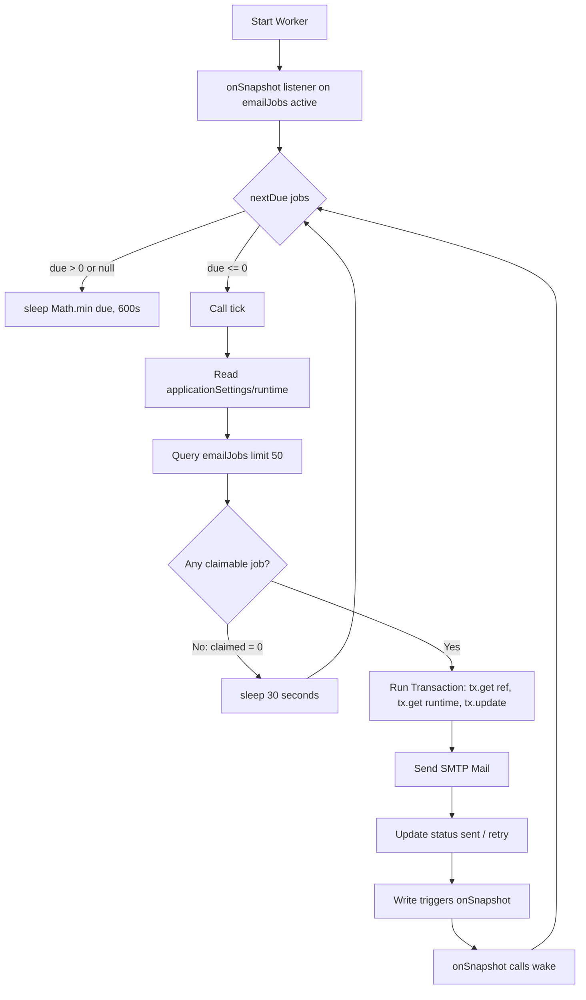

# Firebase Usage & Quota Exhaustion Audit Report

**Project ID:** `conferencemanagement-239a3`<br>
**Database:** Cloud Firestore (Standard Edition, `asia-east1` - Taiwan)<br>
**Firebase Plan:** Spark (Free Tier)<br>
**Primary Quota Breach:** Cloud Firestore Document Reads (**50,000 reads / day** exhausted repeatedly)<br>
**Audit Date:** October 22, 2026<br>

---

## 1. Executive Summary

The project is repeatedly hitting the Cloud Firestore free quota (50,000 document reads/day) due to a combination of:
1. **Background worker loops & listener feedback**: The email queue daemon (`server/worker.ts`) executes queries with an `onSnapshot` listener and drops into a 30-second polling fallback loop on unclaimable jobs, making redundant uncached reads to `applicationSettings/runtime` and re-querying `emailJobs`.
2. **Full-collection table scans in `/api/overview`**: The dashboard overview endpoint queries the entire `people` collection using `select(...)`. In Firestore, projection queries do *not* aggregate on the server—each document returned is billed as a separate read (216 reads per overview load).
3. **Aggressive cache invalidation**: All in-memory memoization caches (`sessions`, `switches`, `overviews`, `emailBranding`) are flushed simultaneously whenever *any* administrative mutation (`POST`, `PUT`, `DELETE`, `PATCH`) occurs. Subsequent requests from any connected client re-trigger 4 separate Firestore reads.
4. **Token revocation checks on every API request**: `auth.verifyIdToken(token, true)` forces a remote check with Google Identity Toolkit rather than verifying the JWT locally.
5. **Direct Flutter mobile app access & security rule read amplification**: The Flutter app queries `/people` directly without pagination. Furthermore, Firestore Security Rules execute `exists()` and `get()` calls on every request, multiplying each client interaction into 3 to 10 billable reads.
6. **Orphaned concurrent dev processes**: Multiple background worker and Vite processes were discovered running simultaneously on the development machine, multiplying polling calls against the live database.

---

## 2. Background Jobs, Scheduled Tasks, and Processes Analysis

### Summary of Running Background Processes

| Process / Task | Location / Service | Frequency / Trigger | Target Firebase Resource | Billable Operations per Execution | Total Daily Impact |
|---|---|---|---|---|---|
| **CONE Email Queue Worker** | `server/worker.ts` (`cone-worker.service` / `npm run dev`) | Real-time `onSnapshot` listener + 30s polling fallback when idle/unclaimable | Firestore `emailJobs`, `applicationSettings/runtime`, `conference/branding` | 1–52 reads per tick, 2 writes per email | **7,200 to 146,000+ reads/day** if stuck or repeatedly polling |
| **Dashboard API Server** | `server/index.ts` (`cone-api.service` / `npm run dev`) | Continuous HTTP daemon | Firestore `adminUsers`, `roleDefinitions`, `applicationSettings/*`, Firebase Auth | 4 Firestore reads + 1 Auth call per cache miss | **15,000 to 45,000+ reads/day** across normal dashboard use |
| **Client Session & Settings Refresh** | `src/App.tsx` (`setInterval`) | Every 60 seconds per open dashboard tab + on window focus (>=30s) | `/api/me` and `/api/workspace-settings` | 0 reads (if cached) or 4 reads per tab on cache bust | **5,760 reads/day** per open tab if cache invalidated |
| **Client Branding Refresh** | `src/Branding.tsx` (`setInterval`) | Every 5 minutes per open tab + on window focus (>=60s) | `/api/branding` | 0 reads (cached) or 2 reads on cache bust | **576 reads/day** per tab |
| **Analysis / Test Reporting** | `server/analyze.ts` (`npm run analyze`) | On manual invocation / CI | Firestore `analysisReports` | 2 writes to live Firestore | Low (manual) |

---

### Deep Dive: Background Email Worker (`server/worker.ts`)

#### 1. Execution Mechanism
The worker is configured as:
- **Local Dev:** Launched concurrently with `tsx watch server/worker.ts` via `npm run dev`.
- **Production:** Managed via systemd service `cone-worker.service` (`node dist-server/server/worker.js`) with `Restart=on-failure`.

#### 2. Workflow & Firebase Interaction


#### 3. Root Cause Issues in the Worker:
1. **Redundant `.get()` inside `tick()`:**
   The worker already holds the list of active jobs in memory via `onSnapshot` (`server/worker.ts:146`). Yet inside `tick()` (line 23), it performs a redundant query:
   ```ts
   const jobs = await db.collection("emailJobs").where("status", "in", active).limit(50).get();
   ```
   This immediately reads up to 50 documents from Firestore even though they were already delivered by the snapshot.
2. **Uncached Runtime Configuration Read:**
   Line 22:
   ```ts
   if (!(await runtimeConfiguration()).emailEnabled) return "disabled";
   ```
   `runtimeConfiguration()` in `server/control.ts:32` directly calls `(await db.doc("applicationSettings/runtime").get()).data()` without caching. Every tick costs 1 read here, plus another read inside the transaction (`tx.get(db.doc("applicationSettings/runtime"))`).
3. **The 30-Second Polling Trap when `claimed === 0`:**
   Line 177–178:
   ```ts
   const result = await tick();
   await sleep(result === "disabled" ? 300000 : result ? 1000 : 30000);
   ```
   If a document in `emailJobs` matches `active = ["queued", "retry", "processing"]` but cannot be leased (for example, if another process holds the lease, or `nextAttemptAt` is corrupt or missing, or `attempts >= 5`), `tick()` returns `0`. Because `0` is falsy, the worker sleeps for only **30 seconds**.
   Every 30 seconds, it repeats `runtimeConfiguration()` (1 read) + `emailJobs.get()` (up to 50 reads).
   - In 1 hour: 120 executions × 51 reads = **6,120 reads**.
   - In 24 hours: **146,880 reads**—almost **3x the entire daily free quota** from a single stalled job.
4. **The `wake()` Feedback Loop:**
   When `tick()` updates an email status to `processing` or `sent`, that write is picked up by `onSnapshot`, which calls `wake()`. `wake()` calls `clearTimeout(timer)` on the sleep promise, causing the worker loop to execute immediately without backoff.
5. **Multiple Orphaned Worker Processes:**
   Process inspection revealed multiple concurrent `node` and `vite` instances active on the machine. Multiple running worker instances compete for the same Firestore documents, triggering transaction collisions and retries (where every retry re-reads the transaction documents).

---

## 3. Major Usage Hotspots Outside the Background Worker

### Hotspot 1: Unaggregated Full-Collection Reads in `/api/overview`
**File:** [server/index.ts](file:///d:/SRHU-Projects/gaurav/cone-admin-dashboard/server/index.ts#L548-L571)
```ts
async function overview(access: ReturnType<typeof overviewAccess>) {
  const [people, redemptions, imports, activity, fees] = await Promise.all([
    access.people
      ? db
          .collection("people")
          .select("isDemo", "archivedAt", "registrationStatus", "role")
          .get()
      : null,
    access.meals ? db.collection("mealRedemptions").count().get() : null,
    ...
    access.fees
      ? db
          .collection("feeRecords")
          .select("amount", "status", "archivedAt")
          .get()
      : null,
  ]);
```
- **The Problem:** Firestore's `.select(...)` only restricts field transmission over the wire; it **does NOT** change billing. Every document returned is billed as 1 document read.
- **Consumption:**
  - With 216 participants in `people`: 216 reads.
  - With `feeRecords`: proportional reads.
  - Total per load: **220–450+ reads**.
- **Impact:** Opening or refreshing the Overview screen just **25 times** exhausts 10,000+ reads. At 150 page views, the entire 50,000 free quota is gone.

### Hotspot 2: Fragile Global Cache Invalidation
**File:** [server/index.ts](file:///d:/SRHU-Projects/gaurav/cone-admin-dashboard/server/index.ts#L254-L258)
```ts
app.use("/api", (req, res, next) => {
  if (req.method !== "GET") res.on("finish", clearRequestCaches);
  next();
});
```
- **The Problem:** `clearRequestCaches()` empties **all** caches in memory (`caches.clear()`).
- Whenever an admin performs any write (updating a user, creating an import, saving a pass, seeding a demo), the caches for:
  - `sessions` (token & user role)
  - `switches` (maintenance mode & runtime config)
  - `publicConferences`
  - `overviews`
  - `branding`
  are completely wiped.
- Immediately after, every active client tab polling `/api/me`, `/api/workspace-settings`, or reloading the overview hits Firestore with 4 to 220+ uncached reads.

### Hotspot 3: Strict Token Verification (`checkRevoked: true`)
**File:** [server/index.ts](file:///d:/SRHU-Projects/gaurav/cone-admin-dashboard/server/index.ts#L261)
```ts
const decoded = await auth.verifyIdToken(token, true);
```
- Passing `true` as the second argument enables revocation checking. This prevents the server from validating the JWT locally with public keys and forces an outbound network request to the Firebase Auth backend on every cache miss.

### Hotspot 4: Mobile App (Flutter) Direct Collection Listing
**File:** [firebase/firestore.rules](file:///d:/SRHU-Projects/gaurav/cone-admin-dashboard/firebase/firestore.rules#L17)
```
match /people/{id} {
  allow get: if verified() && (id == email() || organizer());
  allow list: if organizer();
  allow write: if false;
}
```
- In the mobile app, when an organizer navigates to the People screen, the app queries `people` directly from Firestore without server-side pagination.
- Opening the screen once = **216 reads** (equal to all registered people).
- 5 organizers opening the screen 10 times during a conference session = **10,800 reads**.

### Hotspot 5: Security Rules Read Amplification
**File:** [firebase/firestore.rules](file:///d:/SRHU-Projects/gaurav/cone-admin-dashboard/firebase/firestore.rules#L8-L30)
- In Cloud Firestore, **every `get()` and `exists()` in security rules counts as a billed document read**:
  ```
  function activePerson() {
    return verified() && exists(/databases/$(database)/documents/people/$(email()))
      && (!exists(/databases/$(database)/documents/adminUsers/$(request.auth.uid))
          || get(/databases/$(database)/documents/adminUsers/$(request.auth.uid)).data.status == 'active')
      && get(/databases/$(database)/documents/people/$(email())).data.registrationStatus == 'confirmed';
  }
  ```
  - `exists(people/...)` = 1 read
  - `exists(adminUsers/...)` = 1 read
  - `get(adminUsers/...)` = 1 read
  - `get(people/...)` = 1 read
  - **Total:** 3 to 4 billable reads just to evaluate authorization for 1 document operation.
- In `validRedemption(id)` for meal coupons:
  - `get(couponIndex/$(id))` = 1 read
  - `get(people/$(coupon.email))` = 1 read
  - `get(mealSlots/$(coupon.slotId))` = 1 read
  - **Total:** 7 to 10 reads per meal coupon scan. Scanning 500 lunches generates up to **5,000 reads** solely in security rules.

### Hotspot 6: Orphaned Writes to `auditLogs`
Even though the activity log was migrated to local files (`logs/audit-YYYY-MM-DD.log`), the following code paths still write to Firestore:
- `server/email-otp.ts:146` (`tx.create(db.doc('auditLogs/...'))`)
- `server/email-otp.ts:245` (`tx.create(db.doc('auditLogs/...'))`)
- `server/branding.ts:201` (`tx.create(db.collection('auditLogs').doc(), ...)`)
- `server/delete-user.ts:85` (`tx.create(db.collection('auditLogs').doc(), ...)`)
- `server/setup-admin-test-accounts.ts:142`
- `server/provision-people.ts:240`
There are currently **179 documents** in Firestore's `auditLogs` collection that are never read by the application.

---

## 4. Quantitative Analysis & Math

### Free Plan Limit (Spark Tier)
- **Firestore Reads:** 50,000 / day (resets daily at 12:30 IST / Pacific midnight)
- **Firestore Writes:** 20,000 / day
- **Firestore Deletes:** 20,000 / day

### Realistic Scenario: Why 50,000 Reads Exhausts so Rapidly
Assuming **216 participants**:

| Activity / Component | Reads per Occurrence | Typical Frequency | Daily Reads |
|---|---|---|---|
| **Email Worker with 1 Stuck Job (30s polling)** | 51 reads | 120 times/hour (2,880/day) | **146,880** |
| **Dashboard Overview Page Views** | 220 reads | 50 page views/day | **11,000** |
| **API Middleware (Token + Gate checks on cache bust)** | 4 reads | 1,000 requests/day | **4,000** |
| **Mobile App Organizers viewing People screen** | 216 reads | 30 views across 5 staff | **6,480** |
| **Meal Coupon Scans (Desk check-in)** | 10 reads (incl. rules) | 300 meals | **3,000** |
| **Automated Tests / Seeds against live project** | ~1,500 reads | 3 test runs | **4,500** |
| **Total Estimated Daily Reads** | | | **~175,860** (3.5x over Spark limit) |

---

## 5. Root Cause Summary

1. **Architectural Limit:** The Firebase Spark free tier (50,000 reads/day) cannot support an active conference application where full collections are queried for metrics (`/api/overview`), mobile users fetch complete participant lists, and background workers run continuously.
2. **Worker Query Inefficiency & Short Polling Fallback:** The email worker redundantly calls `.get()` on `emailJobs` despite listening via `onSnapshot`, and falls back to a tight 30-second sleep interval whenever a job is unclaimable, multiplying reads exponentially.
3. **Absence of Server-Side Aggregation for Overview Metrics:** Fetching full document lists rather than utilizing Firestore Count Aggregation (`.count().get()`) or maintaining pre-aggregated summary documents causes hundreds of reads per page load.
4. **Coarse Cache Eviction Strategy:** Clearing all in-memory caches on every write invalidates session tokens, settings, and branding lookups across all connected sessions simultaneously.
5. **Security Rules Overhead:** Evaluating multiple Firestore document lookups inside security rules multiplies mobile client read counts by 3x–4x.

---

## 6. Recommended Action Plan & Fixes

### Phase 1: High-Priority Backend Code Fixes (Immediate)

#### Fix 1: Optimize Email Worker Loop & Remove Redundant Queries
In [server/worker.ts](file:///d:/SRHU-Projects/gaurav/cone-admin-dashboard/server/worker.ts):
1. **Reuse snapshot data in `tick()`** or pass the docs directly from the `onSnapshot` callback rather than executing a new `db.collection("emailJobs").where(...).get()`.
2. **Cache `runtimeConfiguration()`** in `server/worker.ts` with a 1-minute TTL instead of reading `applicationSettings/runtime` on every single iteration.
3. **Increase the idle sleep interval**: When `result === 0`, do not poll every 30 seconds. If `nextDue(jobs)` is in the future or null, rely solely on `onSnapshot` to wake the process.

#### Fix 2: Convert `/api/overview` to Firestore Count Aggregations
In [server/index.ts](file:///d:/SRHU-Projects/gaurav/cone-admin-dashboard/server/index.ts#L548-L571):
Instead of:
```ts
db.collection("people").select("isDemo", "archivedAt", "registrationStatus", "role").get()
```
Use Firestore's native aggregation queries (`.count().get()`):
```ts
const [totalPeople, confirmedPeople] = await Promise.all([
  db.collection("people").where("archivedAt", "==", null).count().get(),
  db.collection("people").where("registrationStatus", "==", "confirmed").count().get(),
]);
```
- In Firestore, `count()` aggregations cost **1 read per up to 1,000 index entries**, rather than 1 read per document.
- Querying counts for 216 participants drops from **216 reads down to 1 read**.

#### Fix 3: Target Cache Invalidation
In [server/request-cache.ts](file:///d:/SRHU-Projects/gaurav/cone-admin-dashboard/server/request-cache.ts) and [server/index.ts](file:///d:/SRHU-Projects/gaurav/cone-admin-dashboard/server/index.ts#L256):
- Do not clear `sessions` or `branding` when a participant or fee record is updated.
- Separate cache namespaces:
  - `sessionCache` (invalidated only on user role change or logout).
  - `overviewCache` (invalidated on participant/meal/fee changes).
  - `brandingCache` (invalidated only when branding settings are saved).

#### Fix 4: Remove Unused Firestore Writes to `auditLogs`
Remove `tx.create(db.doc('auditLogs/...'))` in:
- `server/email-otp.ts` (lines 146 & 245)
- `server/branding.ts` (line 201)
- `server/delete-user.ts` (line 85)
All audit records already log to the local disk via `recordAudit()` in `activity-log.ts`.

#### Fix 5: Paginate People Screen in Flutter App
Ensure the mobile app queries `/people` with `limit(25)` and cursor pagination rather than fetching the entire collection at once.

---

### Phase 2: Production Infrastructure Upgrade

#### Upgrade to Blaze Plan (Pay-as-you-go)
Even with full optimization, a live conference day with 500–1,000 attendees checking passes, receiving emails, and scanning meal coupons will naturally require 70,000 to 250,000 reads.
- **Cost above free quota:**
  - Standard Firestore read pricing: **$0.06 per 100,000 reads** (~₹5 per 100K reads).
  - For a full conference day (250,000 reads), the total cost is approximately **₹10 to ₹25 ($0.12–$0.30)**.
- **Budget Safety:**
  - Set a GCP Budget Alert (e.g. ₹500 or $10/month) with email notifications to eliminate any risk of unexpected charges.
  - Blaze plan is also mandatory for Super Admin SMS-based phone MFA.
